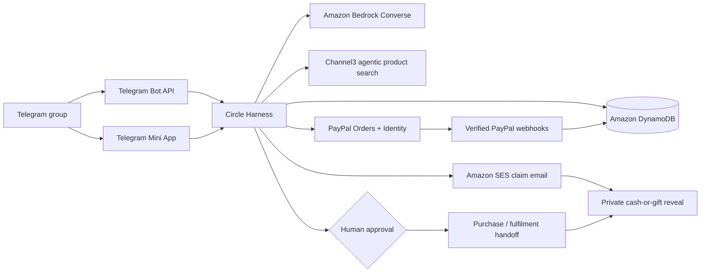

<div align="center">


# WanderWrap Circles 🎁

### Great gifts. Together.

An agentic Telegram Mini App that helps friends remember meaningful moments, understand who they are celebrating, choose the right gift, coordinate PayPal contributions, and deliver an emotional reveal.

[](https://github.com/joboyebisi/wanderwrap-paypal/actions/workflows/ci.yml)


[Product tour](#the-experience) · [Product requirements](docs/PRD.md) · [Architecture](#architecture) · [Local setup](#local-development) · [AWS deployment](infra/README.md) · [Agent harness](docs/AGENT_HARNESS.md) · [Reference decisions](docs/REFERENCE_ARCHITECTURE.md)

</div>


---

## Why WanderWrap

Group gifting starts with warmth and quickly becomes administration: scattered suggestions, awkward reminders, unclear totals and one organiser doing everything. WanderWrap gives the group one calm coordinator inside the conversation they already use.

The AI proposes; people decide. No chat analysis, fundraising, purchase, payout or dispatch crosses a meaningful boundary without clear human approval.

## The experience

1. **Remember the moment** — Spark remembers explicitly supplied birthdays and milestones, then suggests a Circle at the right time.
2. **Understand the recipient** — with group consent, Sage extracts only non-sensitive, gift-relevant preference signals from messages the bot receives.
3. **Choose thoughtfully** — the organiser shares consented public clues; Scout turns them into a budget-aware Channel3 search with live product images, prices, availability and retailer offers.
4. **Fund privately** — Rally coordinates participation and Penny reconciles completed PayPal captures without exposing individual amounts.
5. **Approve and fulfil** — Porter checks the final gift, price, timing and delivery plan, then pauses for organiser approval.
6. **Unwrap emotionally** — Ribbon turns real contributor messages into a delightful reveal where the recipient can choose the PayPal money gift or the personalised product Scout found.

The current sandbox build completes the journey through a verified contribution and an emailed, expiring recipient reveal. Money-gift payout remains visibly locked until PayPal grants the app's Payouts scope.

### Telegram commands

| Command | Purpose |
| --- | --- |
| `/circle Sarah's birthday next Friday, £160` | Start an agent-planned Circle |
| `/remember Sarah, birthday, 2026-12-18` | Save an important date with gentle reminders |
| `/events` | Show remembered moments for the group |
| `/analyse_gifts` | Explicitly enable bounded, gift-only message analysis |
| `/stop_analysis` | Stop analysis and clear the prototype message buffer |
| `/privacy` | Explain the group's privacy and approval contract |

## Agent team

| Agent | Responsibility | Side-effect authority |
| --- | --- | --- |
| **Wrap** · Conductor | Routes work and keeps one coherent group conversation | None |
| **Spark** · Event Radar | Detects explicit upcoming milestones | Suggest only |
| **Sage** · Recipient Insight | Extracts safe gift-relevant preferences | Consent required |
| **Scout** · Gift Curator | Uses consented clues and Channel3 to produce live, budget-aware product cards | None |
| **Rally** · Circle Coordinator | Plans votes, targets and considerate reminders | None |
| **Penny** · PayPal Treasury | Creates orders and reconciles completed captures | Approval + server verification |
| **Porter** · Fulfilment | Prepares purchase and delivery plans | Organiser approval required |
| **Ribbon** · Reveal Director | Builds the recipient unwrapping sequence | Uses submitted messages only |

## Architecture



The custom harness—not the model—owns state transitions, tool execution, idempotency and approval checks. Amazon Bedrock specialists are advisory and use the model-agnostic Converse API. When Bedrock is unavailable locally, deterministic specialists keep the complete product demo usable.

## PayPal experience

- **Link PayPal:** OAuth 2.0 / OpenID Connect opens on PayPal from a deliberate user tap and returns through the Telegram `startapp` deep link.
- **Contribute:** Orders v2 opens the PayPal approval/login experience in the external browser while Telegram stays open.
- **Return:** WanderWrap captures server-side and brings the member back to the active Circle.
- **Ledger:** only verified `COMPLETED` captures increase a campaign total. A Circle is a virtual ledger—not a bank account or crypto wallet.
- **Privacy:** group members see the aggregate goal, never another contributor's amount.
- **Claim:** Ribbon sends an expiring private reveal by Amazon SES. Penny releases money only after PayPal Payouts is enabled and item-level status is verified.

## Technology

- Next.js 16, React 19 and TypeScript
- Official `@tma.js` Mini App SDK with capability detection and Bot API
- Amazon Bedrock Converse API with Amazon Nova 2 Lite by default
- PayPal Orders v2, Identity API and verified webhooks
- Channel3 agentic search with attributed retailer offers
- Amazon SES with DKIM-verified sender identity
- DynamoDB single-table persistence
- AWS App Runner and ECR deployment

## Local development

### Requirements

- Node.js 22+
- PayPal Sandbox business and personal test accounts for end-to-end payment testing
- A Telegram bot and HTTPS tunnel for testing inside Telegram
- Optional authenticated AWS access with Bedrock model access

### Start

```powershell
npm install
Copy-Item .env.example .env.local
npm run dev
```

Open `http://localhost:3000` for browser demo mode. For Telegram, set `NEXT_PUBLIC_APP_URL` to the HTTPS URL configured in BotFather.

### Quality checks

```powershell
npm run check
npm run build
npm audit
```

## Configuration

| Variable | Description |
| --- | --- |
| `NEXT_PUBLIC_APP_URL` | Canonical HTTPS URL used by Telegram and PayPal callbacks |
| `TELEGRAM_BOT_TOKEN` | BotFather token; server only |
| `TELEGRAM_BOT_USERNAME` | Username used for return-to-Telegram deep links |
| `TELEGRAM_WEBHOOK_SECRET` | Verifies Telegram webhook requests |
| `PAYPAL_CLIENT_ID` / `PAYPAL_CLIENT_SECRET` | Sandbox or live REST application credentials; server only |
| `PAYPAL_WEBHOOK_ID` | Verifies PayPal webhook signatures |
| `PAYPAL_OAUTH_STATE_SECRET` | Signs short-lived Log in with PayPal state |
| `PAYPAL_PAYOUTS_ENABLED` | Fail-closed feature flag; keep `false` until scope, payout execution, and webhook reconciliation are all implemented and reviewed |
| `PAYPAL_ENV` | `sandbox` or `live` |
| `AWS_REGION` | Bedrock and DynamoDB source region; default `eu-west-2` |
| `BEDROCK_MODEL_ID` | Bedrock model or inference profile ID |
| `BEDROCK_GUARDRAIL_ID` / `BEDROCK_GUARDRAIL_VERSION` | Optional guardrail applied to every specialist call |
| `CHANNEL3_API_KEY` | Server-only key for live product search and attributed retailer links |
| `CHANNEL3_API_BASE_URL` | Channel3 API base; defaults to `https://api.trychannel3.com/v1` |
| `DYNAMODB_TABLE` | Enables durable AWS persistence when set |
| `SES_FROM_EMAIL` | Verified Amazon SES sender for recipient claim invitations |
| `ALLOW_DEMO_AUTH` | Local-only Telegram authentication bypass; must be `false` in AWS |

Never commit `.env.local`, PayPal secrets, bot tokens or AWS credentials.

## Security and privacy

- Telegram `initData` is validated server-side with the official Web Crypto validator and a one-hour lifetime.
- Telegram webhook updates are secret-verified, deduplicated in DynamoDB and acknowledged before agent work runs.
- Telegram group identity is derived from signed init data rather than trusted from request JSON.
- Chat analysis is opt-in, bounded and stoppable from the group.
- Public-post clues require explicit organiser confirmation; the app stores only the supplied gift summary and never fetches the source URL.
- Channel3 is called server-side with a stable Circle ID for attribution. Retail price and stock are rechecked before any approved purchase.
- PayPal secrets and Bedrock permissions stay server-side.
- OAuth state is signed and expires after ten minutes.
- PayPal create requests are idempotent and captures are reconciled by order ID.
- Side-effecting agent actions fail closed without the exact pending approval.
- App Runner uses an IAM role; production does not require static AWS access keys.
- DynamoDB uses encryption, point-in-time recovery, TTL cleanup and production deletion protection.

Please report vulnerabilities according to [SECURITY.md](SECURITY.md).

## Project status

The product is ready for sandbox integration testing. The live development environment has Telegram, DynamoDB, Bedrock permissions, PayPal collection credentials, a DKIM-verified SES domain, and SES production sending access configured. Channel3 code and UI are ready but remain visibly unconfigured until a server-side API key is added. Remaining account-level work is:

- add `CHANNEL3_API_KEY` locally and to the AWS development secret, then deploy the new revision;
- enable Payouts on the existing PayPal Sandbox Merchant app and wait for the updated OAuth scope;
- subscribe the existing PayPal webhook to payout batch and item events;
- record and verify the two-account Telegram end-to-end demo.

## Hackathon materials

- [Devpost project-details draft](docs/DEVPOST_SUBMISSION.md)
- [Product requirements](docs/PRD.md)
- [Custom agent harness](docs/AGENT_HARNESS.md)

## Contributing

See [CONTRIBUTING.md](CONTRIBUTING.md). By participating, you agree to follow the [Code of Conduct](CODE_OF_CONDUCT.md).

## License

MIT © WanderWrap. See [LICENSE](LICENSE).
